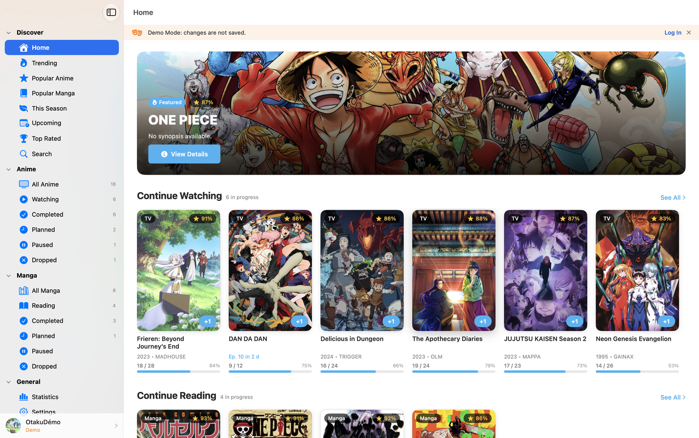
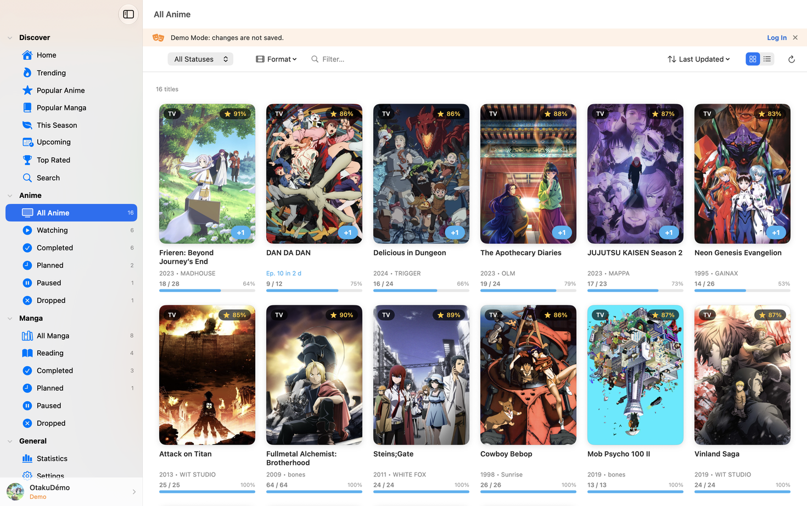
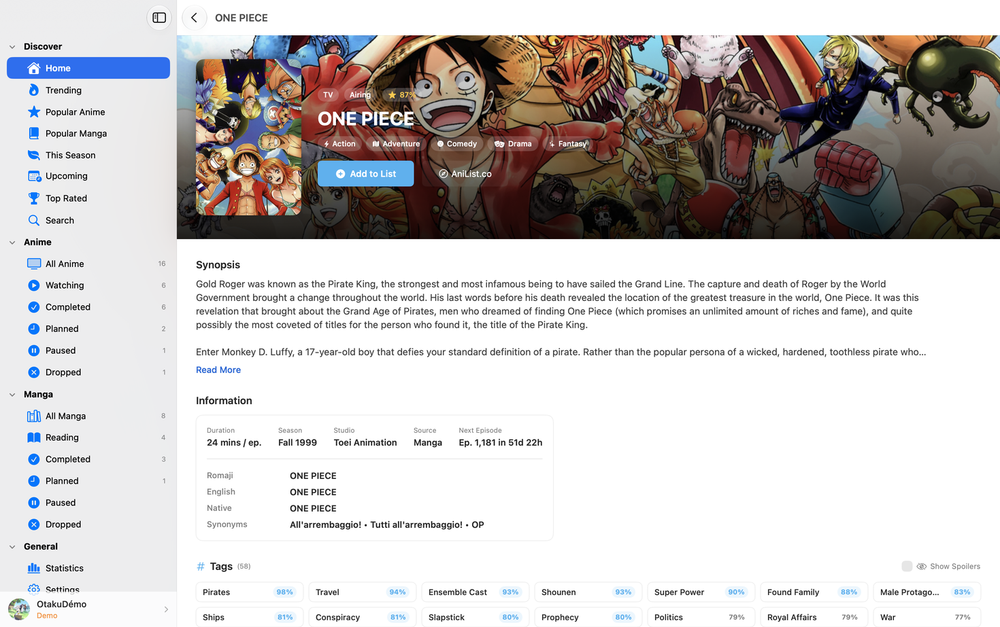
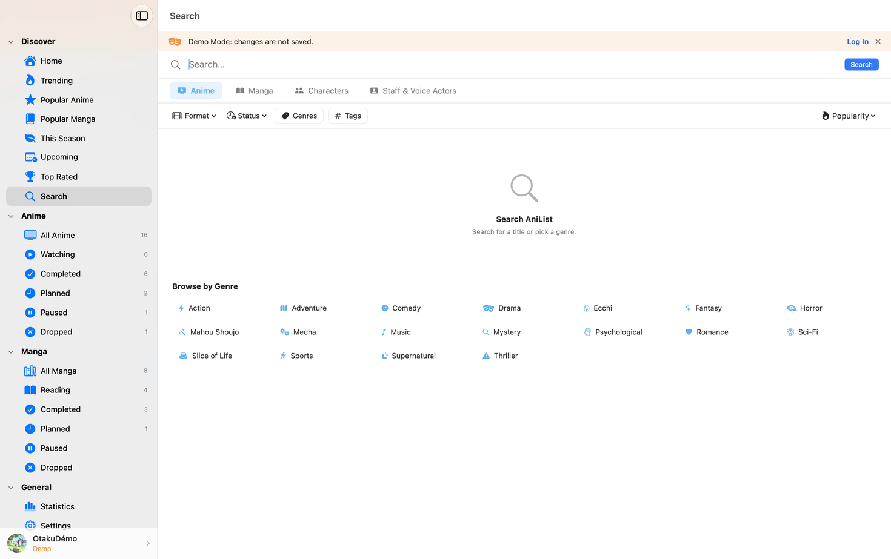

<div align="center">
  
  <h1>AniMac</h1>
  <p>A fast, native macOS desktop &amp; menu bar client for <a href="https://anilist.co">AniList</a>, crafted with SwiftUI &amp; AppKit.</p>

  <p>
    <a href="https://github.com/warkurr/AniMac-Releases/releases/latest"></a>
    
    
    <a href="LICENSE"></a>
  </p>

  <p>
    <a href="https://github.com/warkurr/AniMac-Releases/releases/latest"><strong>⬇ Download Latest .dmg</strong></a>
    &nbsp;·&nbsp;
    <a href="CHANGELOG.md">Changelog</a>
    &nbsp;·&nbsp;
    <a href="https://github.com/warkurr/AniMac-Releases/issues">Report a Bug</a>
    &nbsp;·&nbsp;
    <a href="SECURITY.md">Security &amp; Privacy</a>
  </p>
</div>

---

## Screenshots

<table>
  <tr>
    <th width="50%" align="center">Discovery (Home)</th>
    <th width="50%" align="center">Personal Library</th>
  </tr>
  <tr>
    <td></td>
    <td></td>
  </tr>
  <tr>
    <th align="center">Media Detail</th>
    <th align="center">Global Search &amp; Tag Filter</th>
  </tr>
  <tr>
    <td></td>
    <td></td>
  </tr>
</table>

---

## Features

- **Anime & Manga Library** — Two-way synchronization with AniList, instant `+1` episode/chapter progress updates, grid and table views, custom filtering, and support for all AniList scoring formats (`100-point`, `10-point decimal`, `10-point`, `5-star`, `3-point smiley`).
- **Menu Bar Companion** — Lightweight macOS menu bar popover with real-time airing countdowns, episodes-to-catch-up badges, one-click `+1` progress, background sync, Launch at Login (`SMAppService`), and adjustable Liquid Glass styling.
- **Desktop Airing Notifications** — Native macOS notifications when new episodes of your watching or planned anime air, with configurable lead time and `animac://` deep-link navigation.
- **Discovery & Seasonal Charts** — Browse trending, seasonal, upcoming, and top-rated anime and manga with live airing schedules.
- **Global Search (`⌘F`)** — Fast multi-category search across anime, manga, characters, and staff with genre and tag filtering.
- **Personal Statistics** — Visual breakdown of watch time, episodes, chapters, score distributions, and favorite genres.
- **Native, Private & Lightweight** — Universal 2 binary (`arm64` & `x86_64`), zero third-party SDKs or telemetry, offline cache, automatic in-app updates with SHA-256 verification, and full English & French localization.

---

## Installation

### Option 1 — Homebrew (Recommended)

```bash
brew install --cask warkurr/tap/animac
```

To upgrade later via Homebrew:

```bash
brew upgrade --cask animac
```

### Option 2 — Direct Download (`.dmg`)

1. Download **`AniMac.dmg`** from the [**Latest Release**](https://github.com/warkurr/AniMac-Releases/releases/latest).
2. Open **`AniMac.dmg`** and drag **`AniMac.app`** to your **`Applications`** folder.
3. *(Optional)* Verify the download checksum against `AniMac.dmg.sha256`:
   ```bash
   shasum -a 256 -c AniMac.dmg.sha256
   ```

> **First launch on macOS (Gatekeeper) / Premier lancement sur macOS :**
> Because AniMac is distributed directly outside the Mac App Store without an Apple Developer ID notarization certificate, macOS Gatekeeper will ask for confirmation on the first launch:
> - **English:** Open **System Settings → Privacy & Security**, scroll down, and click **Open Anyway** next to *AniMac* (or run `xattr -cr /Applications/AniMac.app` in Terminal).
> - **Français :** Ouvrez **Réglages Système → Confidentialité et sécurité**, descendez en bas de la page et cliquez sur **Ouvrir quand même** à côté d'*AniMac* (ou exécutez `xattr -cr /Applications/AniMac.app` dans le Terminal).

### Automatic Updates

AniMac includes a built-in updater (**Settings → About → Check for Updates**) that checks this repository for new releases, verifies the `.dmg` SHA-256 checksum and code signature, and installs updates in one click.

---

## Feedback & Bug Reports

Found a bug or have a feature suggestion? Open an issue on the [**Issue Tracker**](https://github.com/warkurr/AniMac-Releases/issues/new/choose).

For security vulnerabilities, please follow our [**Security Policy**](SECURITY.md) and report privately via [GitHub Security Advisories](https://github.com/warkurr/AniMac-Releases/security/advisories/new).

---

## Disclaimer

AniMac is an independent, unofficial third-party client and is not affiliated with, endorsed by, or partnered with AniList or AniChart. All AniList trademarks, logos, and data belong to their respective owners.

## License

Copyright © 2026 Mathieu ([@warkurr](https://github.com/warkurr)). All rights reserved.

AniMac is proprietary software distributed free of charge for personal use. See [LICENSE](LICENSE) for full license terms.
